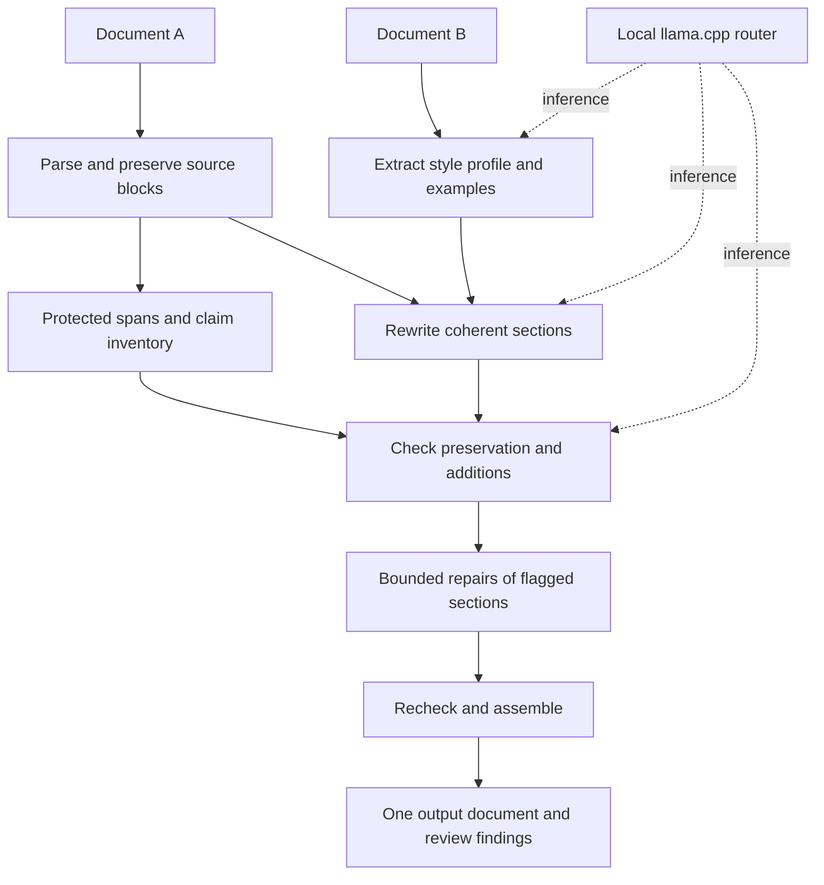

# Recast implementation plan

Date: 2026-10-25. Scope: local application for writing-style transfer. A working 0.1 implementation is now available; see [current status and checks](IMPLEMENTATION_STATUS.md). The milestones below retain the broader evaluation roadmap.

## Product behavior

The user supplies A (content) and B (reference), reviews the inferred writing style, chooses style strength, and receives one rewritten document. The interface also shows source/output comparison and preservation findings. Style strength never relaxes factual preservation.

Initial defaults: preserve A's language, section order, headings, quotations, citations, tables, and code. Rewrite prose bodies. Changes to organization or protected material require a separate explicit option in a later version.

Implemented input/output support for A is UTF-8 text, Markdown, and LaTeX, including pasted text. Style reference B supports DOCX and text-layer PDF, plus TXT/Markdown for convenience. Output keeps A's format. DOCX/PDF output, PDF OCR, reconstructing source layout, and copying B's appearance are outside the current scope.

## Architecture



Implemented stack: Python standard library HTTP server/client, explicit JSON contracts, atomic JSON/filesystem job storage, and a static HTML/CSS/JavaScript interface. This provides an offline runnable checkout without installing dependencies. FastAPI/Pydantic, SQLite, and a frontend framework remain possible later migrations rather than current requirements. The worker runs explicit pipeline stages; no agent framework or vector database is used.

The current interface polls job progress and cancels through a job endpoint, closing active model connections. Stage outputs and section checkpoints persist so interrupted jobs can resume completed work. The app binds to loopback. Uploaded documents are data, never executable instructions, tools, or template definitions. SSE remains an optional transport improvement.

## Data contracts

| Object | Required fields and constraints |
| --- | --- |
| `Document` | ID, content hash, role A/B, source format, language, ordered blocks, original artifact path. |
| `Block` | Stable ID, type, section path, text, source spans, protected ranges. Preserve text and ordering. |
| `StyleProfile` | Version, reference hash, dimensions, confidence, evidence block IDs, example passages, user edits. |
| `Claim` | ID, original source span, proposition, attribution, polarity, modality, linked entities/quantities; extraction may be incomplete. |
| `RewriteSection` | Source block IDs, rewritten blocks, retained protected IDs, model ID, prompt version, generation settings, token usage. |
| `VerificationFinding` | Type, severity, source/output spans, evidence, proposed repair, status; avoid unsupported numeric confidence claims. |
| `Job` | Status, stage, input/profile hashes, selected model, parameters, timestamps, cancellation state, artifacts, unresolved findings. |

Use JSON-schema-constrained outputs for style analysis, claim extraction, rewrites, and verification reports. Validate schema and semantic invariants independently. Never interpret valid JSON as evidence of correct content.

## Inference and resource policy

- Endpoint: `http://127.0.0.1:8017/v1`; explicit IDs `recast-fast`, `recast-default`, `recast-quality`, `recast-gemma`, `recast-sage`.
- Begin with `recast-default` for every stage in a job. Keep model identity separate from stage names.
- One active application job and one in-flight generation; other jobs wait in a bounded queue.
- One resident model (`--models-max 1`), one slot per model (`parallel = 1`), 16,384-token context.
- Starting prompt budget: at most 11,264 tokens including template overhead; at most 4,096 completion tokens; reserve 1,024 tokens of headroom. Obtain counts with the active model's tokenizer rather than character estimates.
- Initial rewrite sections: roughly 600–1,000 words, then adapt to measured tokens and style expansion. Split by paragraph boundaries and include relevant neighboring context. Deduplicate context during assembly.
- If a reference is long, analyze multiple bounded samples across its sections before consolidation. Do not silently use only its opening.
- Start with low-variance extraction/verification and moderately varied rewriting. Record settings; tune them on fixtures rather than assuming one temperature works for every model.
- Keep reasoning disabled for the first latency baseline; validate template behavior and ensure no reasoning trace reaches the document. Evaluate a bounded reasoning setting later only if checks improve.
- Detect truncated completions and invalid block mappings; split/retry instead of exporting incomplete text as successful.
- At most two targeted repair attempts per section. Retain a `needs_review` result when issues remain; do not silently label it verified.
- Separate readiness, cold-loading, generation, and cancellation timeouts. Loading can exceed a short request timeout.
- Backend enforces model IDs, generation budgets, and job limits. The raw localhost router is a trusted development service, not an authorization boundary.

## Milestones and acceptance criteria

### 0. Record research and prepare the runtime

Status: complete for the initial setup; see the [runtime validation record](RUNTIME_VALIDATION.md). Re-run these checks when changing the binary, presets, or model files.

Deliverables: project documents, machine inventory, explicit model preset, launcher, and reproducible checks.

Acceptance: launcher validates file paths; router lists exactly the five configured IDs with no model preloaded; unknown IDs are rejected; one tiny real completion and schema response succeed on a tested model. Record which models were actually tested. No downloads, global settings changes, or shared model-directory scanning.

### 1. Build the evaluation harness before the full UI

Deliverables: CLI accepting A/B paths, direct-prompt baseline, versioned prompts, small human-authored fixtures, JSON/Markdown run reports.

Create approximately 20 fixtures spanning technical and ordinary prose, unrelated A/B topics, mixed references, long inputs, quotations, citations, figures, attribution, and uncertainty. Include adversarial instructions embedded in B. For important claims, store manually expected preservation checks.

Acceptance: repeatable runs record model/prompt versions, settings, tokens, elapsed time, and failures. Every missing fixture-defined protected fact is reported. Compare cold and warm runs separately. Start wiring on 4B and 9B, then prioritize the Gemma 4 26B A4B versus Sage-A1.5 comparison, keeping 27B as a baseline. Record quantization and reasoning settings so differences are not attributed only to architecture. Check both ordinary meaning preservation and factual verification; Sage's agentic training does not establish superiority for writing style.

### 2. Implement parsing and style analysis

Deliverables: TXT/Markdown/LaTeX source readers, DOCX/PDF reference extraction, stable block IDs, protected-span detection, token budgeting, profile schema, representative sample selection, profile editing. These are implemented for the documented common-format subset.

Acceptance: original blocks round-trip without unintended changes; code/quotes/citations remain identifiable; B's factual assertions are not promoted into style rules; weak references surface uncertainty. Profiles are cached by B hash, model, prompt version, and user edits.

### 3. Implement source-linked rewriting

Deliverables: section planner, claim extraction, profile-plus-example rewriting, durable job stages, assembly, cancellation, and retries.

Acceptance: every eligible A block maps to output exactly once; protected blocks remain unchanged; no context overlap is duplicated; long documents fit budgets through chunking; truncation and context overflow produce recoverable errors. Persist the original text alongside the claim inventory.

### 4. Add verification and bounded repair

Deliverables: deterministic protected-span checks, missing/unsupported/contradicted claim checks, reference-content leakage checks, targeted repair, review findings.

Acceptance: fixtures catch altered dates/units/names, changed negation, removed attribution, increased certainty, unsupported additions, and omitted claims. Unresolved material findings set `needs_review`. Test candidate outputs containing planted errors so verification is evaluated independently of generation.

Report style resemblance, meaning preservation, fluency, and performance separately. Select defaults from blind review and observed resource use. A release decision requires no unflagged material errors in the agreed acceptance fixtures; this is a test-suite condition, not a guarantee for arbitrary documents.

### 5. Build the local interface and exports

Deliverables: two upload/paste areas, profile review, style-strength control, model selector, job progress/cancel, source/output comparison, issue links, TXT/Markdown downloads.

Acceptance: a user can complete a job without editing configuration; router unavailability and model loading are understandable; profile edits invalidate affected cached results; output downloads contain only the assembled document. Review findings remain separate artifacts. Document data has an explicit local delete action and is excluded from version control.

### 6. Add document support and optimize from evidence

Deliverables: expanded document export if requested, preserved paragraphs/sections, measured caching improvements, and optional specialized-model benchmark. DOCX/PDF reference extraction was brought forward by the user's format requirements.

Acceptance: the same semantic checks apply to imported documents; unsupported features are identified rather than silently discarded. DOCX formatting is functional and independent of B's appearance. Render representative exports when DOCX support is implemented.

Only then consider stage-specific model routing, TinyStyler/HyperStyler integration, higher context limits, or LoRA training. Each change needs a demonstrated quality or latency benefit on the established evaluation set.

## Proposed repository structure

```text
recast/
  README.md
  docs/                         # research, implementation plan, runtime notes
  config/                       # router preset and future application settings
  scripts/                      # runtime startup and later benchmark entrypoints
  backend/                      # planned: API, pipeline, contracts, persistence
  frontend/                     # planned: upload, comparison, review interface
  prompts/                      # planned: versioned stage templates
  evals/                        # planned: fixtures, expected checks, reports
  tests/                        # planned: semantic and integration checks
  data/                         # ignored: uploaded/generated documents
  .runtime/                     # ignored: isolated cache and runtime logs
```

## First implementation slice

The first runnable slice now includes a CLI and local browser workspace, the requested file adapters, profile editing, protected rewriting, verification, repair, export, cancellation, and resumable checkpoints. Next, expand the human-labeled fixture set and compare Gemma/Sage/9B on actual documents; the initial smoke checks establish operation rather than stylistic quality.
